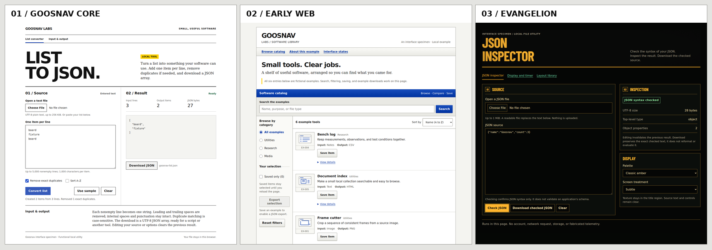

# Goosnav Skill Pack

Reusable Agent Skills for software engineers and founder-operators who need working products, honest evidence, and low-drama operations. Primary skills live at the repository top level and are installed together by default. Secondary, composable protocols live under `extra-skills/` and remain individually installable.

## Primary skills

| Skill | Use it when |
| --- | --- |
| `goosnav-software-productization` | A working local product needs gated cross-platform distribution, later SaaS/mobile expansion, or the existing M1a launcher protocol. |
| `goosnav-mvp-delivery` | An idea must become a complete, launchable vertical slice with a shared core, GUI/CLI, fixtures, verifier, and proof. |
| `goosnav-codebase-upgrade` | A partially working MVP needs adversarial health audits, specialist repairs, end-user/browser proof, security hardening, honest docs, and GitHub readiness. |
| `goosnav-modular-coding-method` | Code must be built one contracted, testbenched black-box module at a time, with human sign-off between bricks and a growing assembly proven at every rung. |
| `nasa-v-model` | An idea must become a complete, traceable specification suite (ConOps → requirements → architecture → detailed design → V&V, with a traceability matrix) before anyone writes code. |
| `aesthetic-web-design` | A web page or app must look genuinely good and intentional — not generic AI/template "slop." Owns art direction, type, color, spacing, and polish. |
| `goosnav-web-design` | A Goosnav Labs site, tool, or workbench needs the core editorial/technical style: strong type, paper and ink, crisp rules, and purposeful primary-color accents. |
| `goosnav-early-web-design` | A Goosnav interface should echo early web catalogs or Windows XP controls, with refined proportions, meaningful color, and modern interaction quality. |
| `minimal-html-web-design` | A page should be built from plain, semantic HTML with little or no CSS — highly functional, fast, accessible, and still sensibly organized. |
| `evangelion-ui` | An interface should be art-directed in the classic Neon Genesis Evangelion instrument language — NERV/MAGI panels, analog CRT rendering, functional information design. |

## Supplemental skills

| Skill | Use it when |
| --- | --- |
| `goosnav-parent-verification` | Delegated agent work must be reconciled against the actual diff, rerun, browser-smoked, classified, and cleaned. |
| `goosnav-local-first-workbench` | A polished browser workbench should run locally, preserve deterministic state, edit workflows, and export portable artifacts. |
| `goosnav-revenue-validation` | Useful software needs a concrete offer and a truthful outreach/signal ledger without invented traction. |
| `goosnav-agentic-orchestration` | Claude, Codex, or local models need bounded assignments, evaluator contracts, recovery handoffs, and an anti-repeat loop. |
| `goosnav-research-simulation` | A research, agent, society, or simulation product needs a deterministic constrained core, replay artifacts, and explicit fictional/safety boundaries. |

Use the narrowest skill that owns the immediate outcome. Combine skills through their handoff artifacts: for example, MVP Delivery can hand a candidate to Parent Verification, Local-First Workbench can hand a product to Software Productization, and Revenue Validation can consume the proof artifact from either. Modular Coding Method consumes a `nasa-v-model` architecture as its module map and hands finished subsystems to Codebase Upgrade or Software Productization.

## Choose a visual direction



Choose one primary design skill for a screen. Keep its typography, geometry, and color roles consistent across the product. The general `aesthetic-web-design` skill can support a quality review; explicit brand rules take precedence over its generic palette and type heuristics.

| Direction | Character | Example request | Working specimen |
| --- | --- | --- | --- |
| **Goosnav core** | Editorial engineering: strong sans headings, Times prose, white space, ruled task regions, square controls; selective red, blue, and yellow. | `Use $goosnav-web-design to redesign this app in the Goosnav Labs style.` | [Local workbench](goosnav-web-design/assets/workbench.html) |
| **Goosnav early web** | Searchable catalogs, visible categories, compact navigation, restrained blue title bars, inset fields, and shallow bevels. Choose a coherent early-web or desktop family for the task. | `Use $goosnav-early-web-design for a refined early-internet software catalog.` | [Searchable catalog](goosnav-early-web-design/assets/catalog.html) |
| **Evangelion instruments** | Condensed instrument type, precise framing, semantic luminous color, optional CRT texture, and real product state. Select explicitly for this direction. | `Use $evangelion-ui to style this JSON workbench with subtle analog effects.` | [JSON inspector](evangelion-ui/assets/inspector.html) and [screen recipes](evangelion-ui/assets/templates/index.html) |

The two Goosnav skills are independently installable. Their source notes distinguish current Labs/3D Comic Engine implementation, documented brand rules, and the owner's October 23, 2026 extension for controlled primary-color accents and refined early-web chrome. Comics artwork, lettering, and assigned product colors keep their own rules. Evangelion remains an optional direction rather than the default Goosnav identity.

To inspect the specimens, open their HTML files from your local checkout in a browser. They include their local CSS/JavaScript resources and need no build step. GitHub's file view displays the source. Install from the source folders to get the current skill, references, and assets.

The former embedded `evangelion-ui.zip` snapshot has been retired so there is one current version of that skill. The folder and its installers include the updated application example.

## Layout

Each skill directory is independently installable and contains `SKILL.md`, `install.sh`, `install.ps1`, and a local validator under `scripts/`. Detailed guidance lives in each skill's `references/`; the software-productization directory also carries its launcher assets. Pack-level installers intentionally discover only top-level skill directories, so supplemental skills are not installed unless selected explicitly.

```text
goosnav-skill-pack/
├── README.md
├── install-all.sh        # ./install-all.sh  (no args = install all for the user)
├── install-all.command   # macOS: double-click to install all
├── install-all.ps1
├── validate-pack.py
├── .gitignore
├── goosnav-software-productization/
├── goosnav-mvp-delivery/
├── goosnav-codebase-upgrade/
├── goosnav-modular-coding-method/
├── nasa-v-model/
├── aesthetic-web-design/
├── goosnav-web-design/
├── goosnav-early-web-design/
├── minimal-html-web-design/
├── evangelion-ui/
└── extra-skills/
    └── goosnav-<supplemental-skill>/
```

## Install all primary skills

macOS or Linux — installs every primary skill for the current user, no arguments needed:

```bash
./install-all.sh
```

On macOS you can also just **double-click `install-all.command`** in Finder; it runs the same thing.

Repository-scoped (optional):

```bash
./install-all.sh --repo /path/to/repository
```

PowerShell equivalents (Windows) — `-Scope User` is the default, so bare invocation installs for the user:

```powershell
.\install-all.ps1
.\install-all.ps1 -Scope Repo -RepoPath C:\path\to\repository
```

To install one primary or supplemental skill, run the corresponding script from that skill directory with the same mode. For example, `./extra-skills/goosnav-parent-verification/install.sh --user`. On macOS every skill directory also carries its own **`install.command`**, so double-clicking that file in Finder installs just that skill for the current user; it reports the failure and waits rather than closing the window if anything goes wrong. Installation copies only that skill into `.agents/skills/<skill-name>`, replaces an older canonical copy, and removes only same-name legacy copies from `.codex/skills` and `.claude/skills`. Installers refuse missing repository roots, filesystem roots, and destinations nested inside their own source skill.

## Safety and data rules

- Installation is local source-to-destination copying. No installer downloads code or contacts a network service.
- Installers strip `.DS_Store` from the staged copy, so Finder metadata never reaches an installed skill. Source folders are left untouched.
- Never place credentials, customer data, personal outreach data, production exports, or user workspaces in this pack.
- Treat fixture/sample modes as visibly fictional and deterministic. Never pass their output off as observed customer or market evidence.
- Use owner gates before sending outreach, spending money, publishing, deleting data, or performing irreversible external actions.
- Keep local services loopback-only by default. Validate all imported paths and exported archives.
- Completion claims must cite commands, artifacts, and observed results; untested platforms and blocked external actions stay explicit.

## Validate the pack

```bash
python3 validate-pack.py
for validator in */scripts/validate_skill.py; do python3 "$validator"; done
for validator in extra-skills/goosnav-*/scripts/validate_skill.py; do python3 "$validator"; done
find . -mindepth 2 -maxdepth 2 -name install.sh -exec bash -n {} \;
find extra-skills -mindepth 2 -maxdepth 2 -name install.sh -exec bash -n {} \;
git diff --check
```

PowerShell parser checks run automatically from `validate-pack.py` when `pwsh` is available.
